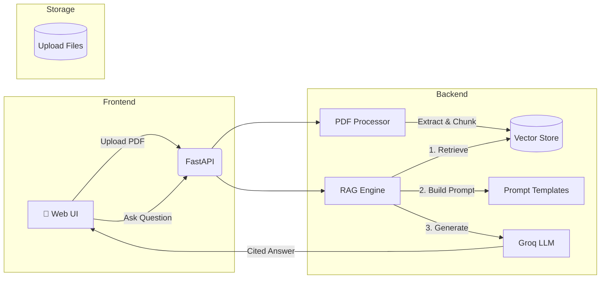

<h1 align="center">📄 DocChat</h1>

<p align="center">
  <strong>AI-powered document Q&A assistant with RAG, citations, and hallucination prevention</strong>
</p>

<p align="center">
  
  
  
  
  
  
</p>

---

## ✨ Features

- 📄 **PDF Upload & Processing** — Drag-and-drop PDF upload with automatic text extraction and intelligent chunking
- 🧠 **RAG Pipeline** — Retrieval-Augmented Generation using ChromaDB vector search and Groq LLM inference
- 📝 **Inline Citations** — Every answer cites its sources with document name, page number, and text snippet
- 🛡️ **Hallucination Prevention** — Explicit "I don't know" responses when documents lack sufficient context
- 💬 **Follow-Up Questions** — Query rewriting turns pronouns and shorthand into standalone search queries
- 🌙 **Clean Responsive UI** — Single-page web app with a sidebar for documents and a distraction-free chat area
- 🐳 **Docker Ready** — One-command deployment with Docker Compose
- 📊 **Built-in Evaluation** — Automated evaluation harness to measure answer quality and citation accuracy

> **Disclaimer:** Educational project. Not for clinical use.

---

## 🎬 Demo

> Upload PDFs → Ask questions → Get cited answers grounded in your documents.

**Screenshot / demo GIF placeholder:** _TODO — add `docs/demo.gif` and replace this line._

Run the app locally (see [Quick Start](#-quick-start)) or with Docker to try it
out.

---

## 🏗️ Architecture



---

## 🛠️ Tech Stack

| Technology | Purpose |
|---|---|
| **Python 3.11** | Core language |
| **FastAPI** | High-performance async API framework |
| **Groq** | Ultra-fast LLM inference (GPT-OSS 20B) |
| **ChromaDB** | Vector database for semantic search |
| **Sentence Transformers** | Document embedding (all-MiniLM-L6-v2) |
| **PyMuPDF (fitz)** | PDF text extraction |
| **Pydantic** | Data validation and settings management |
| **Docker** | Containerized deployment |
| **Vanilla JS** | Zero-dependency frontend |

---

## 🚀 Quick Start

### Prerequisites

- Python 3.11+
- A [Groq API key](https://console.groq.com/keys) (free tier available)

### 1. Clone the repository

```bash
git clone https://github.com/your-username/pdfchatbot.git
cd pdfchatbot
```

### 2. Set up environment variables

```bash
cp .env.example .env
```

Edit `.env` and add your Groq API key:

```env
GROQ_API_KEY=gsk_your_api_key_here
```

> Never commit `.env` — it is ignored by Git. Only `.env.example` belongs in the
> repository.

### 3. Create a virtual environment and install dependencies

```bash
python -m venv venv
# Windows
venv\Scripts\activate
# macOS / Linux
source venv/bin/activate

pip install -r requirements.txt
```

### 4. Run the application

```bash
uvicorn app.main:app --reload
```

### 5. Open in browser

Navigate to **[http://localhost:8000](http://localhost:8000)** — upload a PDF and start chatting!

---

## 🐳 Docker Deployment

```bash
# Create your .env first (see Quick Start)
cp .env.example .env

# Build and start
docker compose up --build

# Run in background
docker compose up -d --build

# Stop
docker compose down
```

The app will be available at **http://localhost:8000**. The image installs the
CPU-only PyTorch wheel and pre-downloads the embedding model, so the container
starts without fetching models at runtime.

Data is persisted via bind mounts:
- `./data` — ChromaDB vector store
- `./uploads` — Uploaded PDF files

---

## ⚙️ Configuration

All settings are optional except `GROQ_API_KEY`. They can be set in `.env` or as
environment variables (see `.env.example` for the full list).

| Variable | Default | Description |
|---|---|---|
| `GROQ_API_KEY` | — | Groq API key (required) |
| `GROQ_MODEL` | `openai/gpt-oss-20b` | Primary answer model |
| `QUERY_REWRITE_MODEL` | `llama-3.1-8b-instant` | Model used to rewrite follow-ups |
| `ANSWER_FALLBACK_MODEL` | `llama-3.3-70b-versatile` | Fallback if the primary model returns nothing |
| `CORS_ORIGINS` | `*` | Comma-separated allowed origins |
| `CHUNK_SIZE` | `1200` | Characters per chunk |
| `CHUNK_OVERLAP` | `200` | Overlap between chunks |
| `TOP_K` | `8` | Chunks retrieved per question |
| `EMBEDDING_MODEL` | `all-MiniLM-L6-v2` | Sentence Transformers model |
| `MAX_UPLOAD_MB` | `50` | Maximum upload size |
| `MAX_CONVERSATIONS` | `500` | In-memory conversations kept before LRU eviction |

> For production, set `CORS_ORIGINS` to your actual domain(s) instead of `*`.

### Cloud deployment

The repository ships a production-ready `Dockerfile`, so it can be deployed to
any container host (Render, Railway, Fly.io, a VPS, etc.). Set `GROQ_API_KEY`
as a secret/environment variable on the host and mount persistent storage for
`/app/data` and `/app/uploads`.

---

## 📡 API Reference

| Method | Endpoint | Description |
|---|---|---|
| `GET` | `/health` | Health check — returns service status |
| `POST` | `/documents/upload` | Upload a PDF document (multipart form) |
| `GET` | `/documents` | List all uploaded documents |
| `DELETE` | `/documents/{document_id}` | Delete a document and its vectors |
| `POST` | `/chat` | Send a question and receive a cited answer |

### Example: Ask a question

```bash
curl -X POST http://localhost:8000/chat \
  -H "Content-Type: application/json" \
  -d '{"question": "What are the main findings?", "conversation_id": null}'
```

**Response:**
```json
{
  "answer": "The main findings include... [Source: report.pdf, Page 3]",
  "sources": [
    {
      "document": "report.pdf",
      "page": 3,
      "text": "Our analysis reveals..."
    }
  ],
  "conversation_id": "abc-123",
  "has_answer": true
}
```

---

## 🔍 How It Works

DocChat uses a **Retrieval-Augmented Generation (RAG)** pipeline:
**chunk → embed → rewrite follow-ups → retrieve → generate with citations**.

1. **Upload & Extract** — When you upload a PDF, PyMuPDF extracts text from every page.

2. **Chunk** — The extracted text is split into sentence-aware chunks (default: 1200 characters with 200-character overlap) so sentences are not cut in half and context is preserved across boundaries.

3. **Embed & Store** — Each chunk is converted to a vector embedding using Sentence Transformers (`all-MiniLM-L6-v2`) and stored in ChromaDB with metadata (document name, page number).

4. **Rewrite Follow-Ups** — When a conversation has history, a fast Groq model rewrites the latest message into a standalone search question (for example, "What about the dose?" becomes "What is the induction dose of propofol?").

5. **Retrieve** — The (possibly rewritten) query is embedded and the top-k most semantically similar chunks are retrieved from the vector store.

6. **Generate** — The retrieved chunks are injected into a carefully crafted prompt along with the conversation history. The Groq LLM (GPT-OSS 20B by default) generates an answer grounded in the context.

7. **Cite & Validate** — The system returns the answer with source citations. If no context is retrieved, the model responds with "I don't know" rather than hallucinating.

---

## 📊 Evaluation

DocChat includes an evaluation harness to measure answer quality:

### Run Evaluation

```bash
python -m evaluation.run_eval
```

### What It Measures

- **Answer Relevance** — Does the answer address the question?
- **Citation Accuracy** — Are sources correctly referenced?
- **Hallucination Detection** — Does the model refuse to answer when it shouldn't know?
- **"I Don't Know" Handling** — Does it correctly abstain on out-of-scope questions?

### Evaluation Data

Edit `evaluation/eval_questions.json` to customize the test set with your own question-answer pairs.

---

## 📁 Project Structure

```
pdfchatbot/
├── app/
│   ├── __init__.py
│   ├── main.py                 # FastAPI app with CORS, lifespan, static files
│   ├── config.py               # Settings via pydantic-settings
│   ├── chat_memory.py          # Terminal chatbot with conversation memory
│   ├── routes/
│   │   ├── __init__.py
│   │   ├── chat.py             # POST /chat endpoint
│   │   ├── documents.py        # Document upload, list, delete endpoints
│   │   └── health.py           # GET /health endpoint
│   ├── services/
│   │   ├── __init__.py
│   │   ├── pdf_processor.py    # PDF extraction and chunking
│   │   ├── vector_store.py     # ChromaDB wrapper
│   │   ├── rag_engine.py       # RAG pipeline orchestration
│   │   └── evaluator.py        # Evaluation harness
│   ├── models/
│   │   ├── __init__.py
│   │   └── schemas.py          # Pydantic request/response models
│   └── prompts/
│       ├── __init__.py
│       └── templates.py        # System and RAG prompt templates
├── evaluation/
│   ├── __init__.py
│   ├── eval_questions.json     # Evaluation question-answer pairs
│   └── run_eval.py             # Evaluation runner script
├── frontend/
│   ├── index.html              # Single-page web application
│   ├── styles.css              # Application styles
│   └── script.js               # Client-side application logic
├── sample_docs/                # Optional local PDFs (ignored by Git)
├── data/                       # ChromaDB persistent storage (ignored)
├── uploads/                    # Uploaded PDF storage (ignored)
├── scripts/
│   └── reindex.py              # Rebuild the vector index from a PDF
├── Dockerfile                  # Container build instructions
├── .dockerignore               # Files excluded from the Docker build context
├── docker-compose.yml          # Docker Compose configuration
├── requirements.txt            # Python dependencies
├── .env.example                # Environment variable template
├── .gitignore                  # Git ignore rules
├── LICENSE                     # MIT license
└── README.md                   # This file
```

---

## 💡 Key Design Decisions

### Why Chunking with Overlap?

Splitting documents into fixed-size chunks with overlap ensures that no important context is lost at chunk boundaries. A sentence that spans two chunks will appear fully in at least one, preserving semantic coherence for the embedding model.

### Why "I Don't Know" Handling Matters

Most RAG systems hallucinate when the retrieved context doesn't contain the answer. DocChat explicitly instructs the LLM to say *"I don't have enough information in the provided documents to answer this question"* when context is insufficient. This is critical for trust in professional settings — a system that says "I don't know" is more reliable than one that fabricates answers.

### Why Citation Is Crucial for Trust

Every answer includes source citations (document name, page number, and text snippet). This allows users to:
- **Verify** the answer against the original document
- **Navigate** directly to the relevant section
- **Build confidence** in the system's outputs

### Evaluation Methodology

The built-in evaluation harness tests the system against predefined question-answer pairs, measuring not just answer quality but also the model's ability to abstain when appropriate. This ensures that improvements to one aspect (e.g., retrieval) don't degrade another (e.g., hallucination prevention).

---

## 🔮 Future Improvements

- 📂 **Multi-format Support** — Word documents, plain text, Markdown, and HTML
- 🔐 **Authentication** — User accounts with per-user document isolation
- ⚡ **Streaming Responses** — Real-time token streaming via Server-Sent Events
- 🎯 **Advanced Retrieval** — Hybrid search (semantic + keyword), re-ranking, and query expansion
- 📈 **Analytics Dashboard** — Usage metrics, query patterns, and answer quality tracking
- 🌐 **Multi-language** — Support for non-English documents and queries
- 🧪 **Comprehensive Evaluation** — Larger test sets, automated regression testing, RAGAS metrics

---

## ⚠️ Known Limitations

- **Text-based PDFs only** — scanned/image-only PDFs need OCR before upload.
- **No authentication** — every visitor shares the same document collection and conversation store.
- **In-memory conversations** — history is lost on restart and is not shared across multiple server workers.
- **Fixed retrieval settings** — one embedding model and one chunk size; there is no hybrid search or re-ranker.
- **LLM answers can still be wrong** — always verify the cited page before relying on an answer.
- **Large PDFs are slow** — processing time and memory grow with document size.
- **Not a medical device** — **Educational project. Not for clinical use.**

---

## 🔐 Security Notes

- `.env` is git-ignored. Never commit API keys; use `.env.example` as a template.
- Uploaded PDFs and the vector store (`uploads/`, `data/`) are git-ignored and
  should not be published.
- Set `CORS_ORIGINS` to your production domain(s) instead of `*`.
- Uploads are limited to `MAX_UPLOAD_MB` (default 50 MB) and validated as PDFs.

---

## 📄 License

This project is licensed under the **MIT License**. See [LICENSE](LICENSE) for details.

---

<p align="center">
  Built with ❤️ using FastAPI, Groq, ChromaDB, and vanilla JavaScript
</p>
